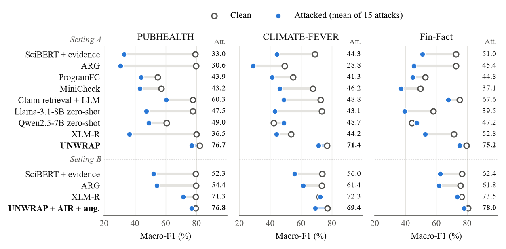
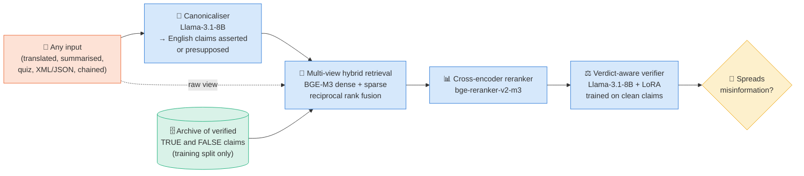
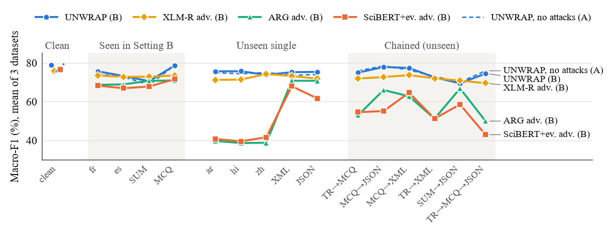

<div align="center">

# 🛡️ UNWRAP

### Verify the Claim, Not the Text
**Format-Shifting Attacks on Misinformation Detectors and a Robust Defence**


</div>

---

## 💡 The idea in one picture

A false claim can be **translated, summarised, turned into a quiz question, or wrapped in XML/JSON** without changing a single word of what it claims. Published misinformation detectors collapse under these *format-shifting attacks*. **UNWRAP** stays robust because it verifies the **claim**, not the **text**.

<p align="center">
  
</p>

<p align="center"><sub>Macro-F1 on clean claims (rings) and averaged over 15 attacks (dots). Setting A: no attacked text in training. Setting B: all detectors also trained on transformed claims.</sub></p>

---

## ⚔️ The attacks

Every attack keeps the claim intact and changes only its **format**, then adds the task request a downstream LLM would execute.

| | Attack | Example of what the detector receives |
|:-:|---|---|
| 🌍 | **Translation** (fr, es, ar, hi, zh) | *"Translate from Arabic to English:"* + the claim, expanded and translated |
| 📰 | **Summarisation** | *"Summarize the following text…"* + a 500-word article built around the claim |
| ❓ | **Multiple-choice question** | *"Why might eating more fish prevent Parkinson's disease? A) … B) …"* |
| 🧾 | **XML / JSON** | *"Parse the following JSON object…"* + the claim serialised as data |
| 🔗 | **Chains** (6) | e.g. translate ➜ MCQ ➜ JSON |

Attacks are generated with **Qwen2.5-32B-Instruct**, and an independent judge (**Gemma-3-12B**) checks that each attacked text still conveys the claim (92.7% do).

---

## 🧠 How UNWRAP works



---

## 📈 Main results

Macro-F1 (%), **clean → mean over the 15 attacks**, full test sets.

| Detector | PUBHEALTH | CLIMATE-FEVER | Fin-Fact |
|---|:-:|:-:|:-:|
| SciBERT + evidence (Kotonya & Toni, 2020) | 79.2 → 33.0 🔻 | 69.1 → 44.3 🔻 | 72.8 → 51.0 🔻 |
| ARG (Hu et al., 2024) | 79.8 → 30.6 🔻 | 49.3 → 28.8 🔻 | 72.8 → 45.4 🔻 |
| Llama-3.1-8B zero-shot | 77.6 → 47.5 🔻 | 73.5 → 43.1 🔻 | 58.1 → 39.5 🔻 |
| XLM-R, adversarial training | 79.4 → 71.3 | 72.0 → **72.3** | 76.4 → 73.5 |
| **🛡️ UNWRAP** (no attacked training data) | **82.0 → 76.7** | **77.0** → 71.4 | 79.5 → 75.2 |
| **🛡️ UNWRAP + AIR + aug.** (same data as adv. training) | 79.4 → **76.8** | 77.1 → 69.4 | **80.6 → 78.0** |

✅ Compared under the same training conditions, UNWRAP is **significantly more robust in 32 of 33** detector–dataset comparisons (paired bootstrap, *p* < 0.05); the remaining one is a statistical tie.

<p align="center">
  
</p>

<p align="center"><sub>Adversarial training helps on the attack types it saw, but SciBERT and ARG collapse on unseen languages and chains. UNWRAP stays flat, with or without transformed training data.</sub></p>

---

## 🗂️ Repository structure

```
📦 Robust_Misinformation_Detection
├── 🐍 code/                 all experiments (one script per stage)
│   ├── prep_data.py         binary splits of the three benchmarks
│   ├── gen_attacks.py       15 format-shifting attacks (Qwen2.5-32B)
│   ├── validate_attacks.py  claim-preservation judge (Gemma-3-12B)
│   ├── adaptive_attacks.py  injection and decoy attacks
│   ├── canonicalize.py      UNWRAP canonicaliser
│   ├── retrieval.py         BGE-M3 / mE5 / AIR indexes, multi-view fusion
│   ├── train_verifier.py    LoRA verifier on clean training claims
│   ├── train_air.py         attack-invariant retriever (Setting B)
│   ├── detect.py            UNWRAP and LLM / retrieval / MiniCheck baselines
│   ├── clf.py, kotonya_run.py, arg_run.py, programfc_run.py   published baselines
│   ├── aggregate.py, compare.py, seen_unseen.py               metrics and paired bootstrap tests
│   ├── contamination.py, api_zs.py, subsample_eval.py         contamination check, Claude run
│   ├── make_tables.py, make_figures.py, make_appendix.py      every table / figure of the paper
│   ├── tests.py             ~78k checks against reference implementations
│   └── baselines/           official ARG and ProgramFC code (see SOURCES.txt)
├── 📊 data/
│   ├── raw/                 original benchmark files
│   ├── processed/           claims + evidence archive per dataset
│   └── attacks/             attacked test sets + preservation labels
├── 📋 results/
│   ├── tables/              all result CSVs (summary, comparisons, ablations)
│   ├── contamination/       contamination-test completions and scores
│   └── preds_api/           Claude Opus 5.5 predictions (subsample)
└── 🖼️ assets/               figures for this README
```

---

## 🚀 Reproducing

The experiments ran on a SLURM cluster, each job on one GPU with ≥ 80 GB of memory.

```bash
# 1. data and attacks
python code/prep_data.py
python code/gen_attacks.py --dataset pubhealth          # repeat per dataset
python code/validate_attacks.py --dataset pubhealth

# 2. UNWRAP
python code/retrieval.py --dataset pubhealth climatefever finfact --encoder bgem3
python code/canonicalize.py --dataset pubhealth --kind ours
python code/train_verifier.py --stage canon && python code/train_verifier.py --stage data
python code/train_verifier.py --stage train --seed 0
python code/detect.py --dataset pubhealth --method ours --verifier_lora <adapter dir> --tag vtrained

# 3. results
python code/aggregate.py && python code/compare.py ours_vtrained clf_xlmr-advtrain
python code/tests.py                                    # must print ALL ... CHECKS PASSED
```

`code/submit_all.sh` and `code/submit_baselines.sh` submit the complete pipeline, including all baselines, ablations and seeds.

---

## 📚 Datasets

| Dataset | Domain | Train / Dev / Test | Split |
|---|---|:-:|---|
| 🩺 [PUBHEALTH](https://github.com/neemakot/Health-Fact-Checking) | public health | 8,077 / 1,009 / 985 | official |
| 🌡️ [CLIMATE-FEVER](https://github.com/tdiggelm/climate-fever-dataset) | climate | 544 / 90 / 272 | ours, stratified 60/10/30 |
| 💹 [Fin-Fact](https://github.com/IIT-DM/Fin-Fact) | finance | 1,929 / 275 / 551 | ours, stratified 70/10/20 |

Binary true/false subsets. Please respect the original licences of each benchmark.

---

<div align="center">

🔒 *Private research repository. Paper in preparation.*

</div>
